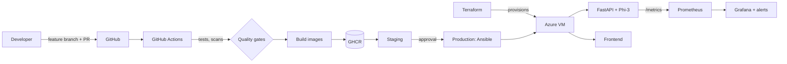

# Flowchart Generation System using Fine-Tuned Phi-3

[](https://github.com/Joelrtharakan/flowchartgenerator/actions/workflows/ci-cd.yml)


## Overview

This project implements an end-to-end system for generating Mermaid flowcharts from natural language prompts using a fine-tuned large language model.

The system is built around the **Phi-3 Mini Instruct** model and enhanced using **LoRA-based fine-tuning** on domain-specific data.

### Features

* Natural language to Mermaid flowchart generation
* Continuous dataset expansion via PostgreSQL
* Automated retraining pipeline
* Deployment on Azure Virtual Machine using FastAPI
* Real-time logging and monitoring
* Dedicated frontend for generation and logging visualization

### DevOps architecture



More detail: [DevOps guide](docs/DEVOPS.md) | [Report](docs/REPORT.md) | [Viva Q&A](docs/VIVA_QA.md) | [Presentation runbook](docs/PRESENTATION.md) | [Contributing](CONTRIBUTING.md)

---

## Architecture

The system consists of three major components:

### 1. Training Pipeline
* Fetches prompt-flowchart pairs from PostgreSQL
* Applies filtering and formatting
* Fine-tunes Phi-3 using standard LoRA
* Saves LoRA adapters (lightweight model updates)
* Evaluates using `test_model.py` and monitors drift with `monitor.py`

### 2. Inference API
* FastAPI-based backend (`training/app.py`) deployed on Azure VM
* Loads base Phi-3 model + LoRA adapter
* Accepts prompts and returns Mermaid flowcharts
* Provides logging endpoints for monitoring

### 3. Frontend Endpoints
* Simple web UI served on Python HTTP server (`frontend/`)
* Displays flowcharts natively
* Dedicated logs web interface (`frontend-logs/`) 
* Inference running on Azure VM (`20.219.147.18`)

---

## Project Structure

```text
.
├── data/                   # Train, Test, and Validation JSONL datasets
├── frontend/               # Frontend Generation Web App
│   ├── app.js
│   ├── index.css
│   ├── index.html
│   └── server.py           # Local HTTP Server for frontend
├── frontend-logs/          # Frontend Logs Web App
│   └── index.html
├── tests/                  # Unit tests (API, frontend proxy, dataset script)
├── k8s/                    # Kubernetes manifests (kustomize)
├── terraform/              # Azure infrastructure as code
├── terraform-local/        # Local kind cluster as code (no cloud account needed)
├── ansible/                # VM configuration and stack deployment
├── monitoring/             # Prometheus rules + Grafana dashboards
├── docs/DEVOPS.md          # DevOps guide mapped to the course rubric
├── Dockerfile.api / Dockerfile.frontend / docker-compose.yml
└── training/               # Fine-tuning, Validation, and inference codebase
    ├── app.py              # FastAPI inference server
    ├── monitor.py          # Data/Model drift monitoring & retraining system
    ├── train_phi3.py       # Fine-tuning script (GPU required)
    ├── test_model.py       # Model testing script
    ├── current_model.txt   # File indicating the currently active LoRA adapter
    ├── requirements.txt    # Python dependencies
    └── phi3-finetuned/     # Output LoRA adapter files and checkpoints
```

---

## Model Details

* **Base Model:** microsoft/phi-3-mini-4k-instruct
* **Fine-tuning Method:** LoRA (full precision float32)

### Frameworks Used

* Transformers
* PEFT (LoRA)
* Accelerate
* FastAPI (Inference)
* Mermaid.js (Frontend Chart Rendering)

* **Training Device:** GPU required (local, Colab, or cloud GPU)
* **Inference Device:** CPU (Azure VM)

---

## Training Pipeline

### Requirements

* CUDA-enabled GPU
* PostgreSQL database with training data

### Environment Variables

```text
DB_HOST
DB_USER
DB_PASSWORD
DB_NAME (optional)
```

### Run Training

```bash
cd training
python train_phi3.py
```

### Output

LoRA adapter will be saved in:

```text
training/phi3-finetuned/
```

---

## DevOps Pipeline

Containerized (multi-stage Docker), tested and scanned in GitHub Actions, provisioned with Terraform,
deployed with Ansible/Kubernetes, and monitored with Prometheus + Grafana.
See **[docs/DEVOPS.md](docs/DEVOPS.md)** for architecture, setup and demo steps, and
**[CONTRIBUTING.md](CONTRIBUTING.md)** for the branching and PR workflow.

```bash
cp .env.example .env
SKIP_MODEL_LOAD=1 docker compose up -d --build   # API :8000, UI :8082, Prometheus :9090, Grafana :3000
```

---

## Deployment on Azure VM (manual)

### 1. Setup VM

* Ubuntu 22.04 or later
* Open port **8000** for API and **8082** for Frontend

### 2. Transfer Files & Dependencies

```bash
scp -r training/app.py azureuser@<VM_IP>:~
scp -r training/phi3-finetuned azureuser@<VM_IP>:~
```

```bash
sudo apt update
sudo apt install python3.12-venv unzip -y

python3 -m venv venv
source venv/bin/activate

pip install --upgrade pip
pip install fastapi uvicorn torch transformers peft accelerate psycopg2-binary
```

### 3. Run FastAPI Model API (Backend)

```bash
cd training
uvicorn app:app --host 0.0.0.0 --port 8000
```

### 4. Run Frontend

```bash
cd frontend
python3 server.py
```

### 5. Access Endpoints

* **Frontend Web UI:** `http://<VM_IP>:8082`
* **Swagger UI:** `http://<VM_IP>:8000/docs`
* **Logs UI:** Hosted interface under frontend-logs directory 

---

## API Usage

### Endpoint

```http
POST /generate
```

### Request Body

```json
{
  "prompt": "Deploy model in Azure"
}
```

### Response

```json
{
  "flowchart": "flowchart TD\nA --> B ..."
}
```

---

## Logging System

The system logs:

* Incoming prompts
* Generated outputs
* Runtime events

### Log Endpoints via API (`training/app.py`)
* `GET /logs/api`
* `GET /logs/monitor`

Logs can also be accessed interactively via the frontend-logs web UI.

---

## Model Versioning

The system relies on `training/current_model.txt`.

This file controls which LoRA adapter version the FastAPI app attempts to load upon startup (e.g. `phi3-finetuned/checkpoint-50`).

### Benefits
* Hot-swappable model instances
* Fast rollback without backend codebase modifications
* Decoupled state representations 

---

## Future Enhancements

* Automatic database polling trigger for `monitor.py`
* Dataset growth detection metrics
* Advanced interactive UI features in frontend apps
* CI/CD pipeline for deployment
* GPU-based Azure deployment scaling options

---

## Key Design Decisions

* **QLoRA** implemented to reduce memory footprint heavily during training loops
* **LoRA adapters** instead of full-precision structural model cloning ensures disk feasibility
* **Frontend Proxy:** Custom simple python HTTP server mitigates client-side CORS to inference endpoint 
* Componentized modular codebase structure grouping logical sets into `frontend/` and `training/`

---

## Conclusion

This project demonstrates a scalable pipeline for fine-tuning LLMs on structured task generation and deploying them scalably using decoupled components. The pipeline architecture ensures fluid extensibility for monitoring, retraining loops, and comprehensive full-system web accessibility.
