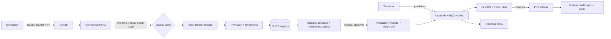

# DevOps Implementation Guide

This document maps the project to the DevOps skill-based evaluation rubric and explains how to run each part.

## Architecture



## Rubric mapping

| Rubric criterion | Evidence in this repo |
|---|---|
| DevOps ecosystem, version control, collaboration | [CONTRIBUTING.md](../CONTRIBUTING.md) (lifecycle, branching, PR flow, conflict handling), PR template, Dependabot, protected `master`, feature branches |
| CI/CD pipeline automation | [.github/workflows/ci-cd.yml](../.github/workflows/ci-cd.yml): lint (ruff), SAST (bandit), unit tests + coverage artifact, secret scan, IaC validation, image build, Trivy scan, smoke test, registry publish, staging, gated production deploy |
| Containerization and orchestration | Multi-stage non-root [Dockerfile.api](../Dockerfile.api), [Dockerfile.frontend](../Dockerfile.frontend), [docker-compose.yml](../docker-compose.yml), images in GHCR, Kubernetes manifests in [k8s/](../k8s) (Deployments, Services, HPA scaling, rolling updates with `maxUnavailable: 0`, probes, PVC) |
| IaC, cloud deployment, monitoring | [terraform/](../terraform) (Azure RG, VNet, NSG, public IP, VM), [ansible/](../ansible) (Docker install, firewall, stack deploy), Prometheus + Grafana + alert rules in [monitoring/](../monitoring), app logs endpoints, secrets via GitHub Secrets / K8s Secret / `.env` (never committed), Trivy + bandit + gitleaks scanning |
| Documentation and presentation | This guide, README, architecture diagram, demo script below |

## Run it locally (Docker Compose)

```bash
cp .env.example .env            # set GRAFANA_ADMIN_PASSWORD
SKIP_MODEL_LOAD=1 docker compose up -d --build   # demo mode, no 7 GB model
# full mode: place adapters in training/models/ and training/models/current_model.txt (containing e.g. `models/v1`), then omit SKIP_MODEL_LOAD; with no adapter the base Phi-3 model is served
```

| Service | URL |
|---|---|
| Frontend | http://localhost:8082 |
| API docs / health / metrics | http://localhost:8000/docs, `/health`, `/metrics` |
| Prometheus | http://localhost:9090 (Status -> Targets, Alerts) |
| Grafana | http://localhost:3000 (dashboard: *Flowchart API*) |

## Kubernetes (minikube / kind / AKS)

```bash
kubectl apply -f k8s/base/namespace.yaml
kubectl -n flowchart create secret generic flowchart-secrets --from-literal=HF_TOKEN=<token>
# edit images in k8s/base/kustomization.yaml (ghcr.io/<owner>/flowchart-*), then:
kubectl apply -k k8s/base
kubectl -n flowchart get pods,svc,hpa
# rolling update demo
kubectl -n flowchart set image deploy/api api=ghcr.io/<owner>/flowchart-api:<new-sha>
kubectl -n flowchart rollout status deploy/api
kubectl -n flowchart rollout undo deploy/api
# scaling demo
kubectl -n flowchart scale deploy/api --replicas=4
```

## No cloud account? Run everything locally

Terraform creates a 3-node Kubernetes cluster inside Docker (kind), then the app is deployed onto it:

```bash
cd terraform-local && terraform init && terraform apply -auto-approve && cd ..
docker build -f Dockerfile.api --build-arg REQUIREMENTS=requirements-lite.txt -t flowchart-api:lite .   # small image, no model
docker build -f Dockerfile.frontend -t flowchart-frontend:local .
kind load docker-image flowchart-api:lite flowchart-frontend:local --name flowchart
kubectl apply -k k8s/overlays/local
kubectl -n flowchart get pods,svc,hpa      # frontend: http://localhost:8082
# teardown
cd terraform-local && terraform destroy -auto-approve
```

The local overlay uses small resource limits and `SKIP_MODEL_LOAD=1`, so the API answers `/health` and `/metrics` but `/generate` returns 503 until a model is mounted.

## Provision and deploy to Azure

```bash
cd terraform
cp terraform.tfvars.example terraform.tfvars   # add your SSH public key + your IP
az login && terraform init && terraform plan && terraform apply
cd ../ansible
cp inventory.ini.example inventory.ini         # use the public_ip output
GRAFANA_ADMIN_PASSWORD=... ansible-playbook playbook.yml -e image_owner=<github-user>
# copy LoRA adapters + current_model.txt into /opt/flowchart/models on the VM
```

Grafana and Prometheus listen on `127.0.0.1` on the VM; reach them with
`ssh -L 3000:localhost:3000 -L 9090:localhost:9090 azureuser@<ip>`.

## GitHub setup for the pipeline

| Item | Where | Value |
|---|---|---|
| Environments `staging`, `production` | Settings -> Environments | Add required reviewers to `production` for manual approval |
| Variable `DEPLOY_ENABLED` | Settings -> Variables | `true` once the VM exists |
| Secrets `VM_HOST`, `VM_USER`, `VM_SSH_KEY`, `GRAFANA_ADMIN_PASSWORD` | Settings -> Secrets | from Terraform output / your key |
| Branch protection on `master` | Settings -> Branches | see CONTRIBUTING.md |

Images are pushed to `ghcr.io/<owner>/flowchart-api` and `flowchart-frontend`; set the packages to public or give the VM a pull token.

## Suggested demo script (for the viva / presentation)

1. Show the PR from a `feature/*` branch; CI checks run (lint, tests, scans).
2. Merge; show the pipeline stages go green and the image appear in GHCR.
3. Show the Trivy results in the Security tab.
4. `docker compose up`, send a prompt in the UI, show `/metrics`.
5. Open Grafana: request rate and latency move; stop the API container to trigger the `ApiDown` alert in Prometheus.
6. Show `kubectl rollout` and `scale`, then `terraform plan` output.

## Verified deployment (Azure, Central India)

| Item | Result |
|---|---|
| Terraform (`terraform/`) | `apply` created 8 resources (resource group, VNet, subnet, NSG, public IP, NIC, VM) |
| VM | Ubuntu 22.04, 4 vCPU / 15 GB, Docker installed by cloud-init |
| Compose stack on the VM | API, frontend, Prometheus and Grafana running; Prometheus target `flowchart-api` is up; 3 alert rules loaded; Grafana dashboard provisioned |
| End-to-end request | Frontend -> API -> Phi-3 -> valid Mermaid returned (about 1 minute on CPU) |
| Kubernetes (kind on the VM) | `k8s/overlays/local` applied: 2 API + 2 frontend pods, services respond to `/health`; scaled API 2 -> 4; rolling update (revision 2) and `rollout undo` succeeded |
| Local checks | 26 unit tests, ruff, bandit clean; `terraform validate` passes for both Terraform configs; Ansible syntax check passes |

The HorizontalPodAutoscaler shows `<unknown>` on the demo cluster because it has no metrics-server.

## Known limitations

- The model (Phi-3 + LoRA adapters) is not baked into the image or the repo; adapters are mounted from a volume/PVC.
- CPU inference is slow; the `SlowGeneration` alert threshold (60 s) reflects that.
- The fine-tuned LoRA adapter was lost with the previous VM; the deployment serves base Phi-3 with a guided prompt and output cleanup. Mount adapters to use the fine-tuned model.
- Terraform state is local. For a team, add an `azurerm` remote backend.
