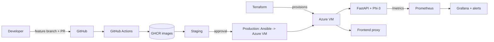

# DevOps Case Study Report: Flowchart Generation System

**Course:** DEVOPS (24DC2006), B.Tech Semester VII
**Project:** End-to-end DevOps implementation for an LLM-based Mermaid flowchart generator (Phi-3 mini with LoRA)

> Replace the bracketed items with your own details (name, roll number, screenshots) before submitting.

## 1. Introduction
The application turns a natural-language prompt into a Mermaid flowchart using Microsoft Phi-3 mini, optionally fine-tuned with LoRA. A FastAPI service performs inference and a small web frontend renders the result. This report describes how the project was taken through a complete DevOps lifecycle: version control, CI/CD, containers, orchestration, infrastructure as code, cloud deployment, monitoring and security scanning.

**Objectives**
- Automate build, test, scan and release of every change.
- Package the system as reproducible containers and run it on Kubernetes.
- Provision cloud infrastructure from code and deploy it repeatably.
- Observe the running system with metrics, dashboards and alerts.

## 2. Architecture

| Component | Technology |
|---|---|
| Model | Phi-3 mini 4k instruct, LoRA fine-tuning (PEFT) |
| API | FastAPI, Uvicorn, Prometheus instrumentation |
| Frontend | Python proxy server, Mermaid.js |
| CI/CD | GitHub Actions |
| Containers | Docker (multi-stage), Docker Compose, GHCR |
| Orchestration | Kubernetes (kustomize), kind |
| IaC | Terraform (Azure), Ansible |
| Monitoring | Prometheus, Grafana |
| Security | bandit, Trivy, gitleaks, hadolint, Dependabot |

## 3. Version control and collaboration
- Repository on GitHub with a protected `main` branch.
- Branching: short-lived `feature/*`, `fix/*`, `infra/*` branches; changes land through pull requests that must pass CI (see `CONTRIBUTING.md`).
- Agile: work tracked as issues in one-week sprints.
- Merge conflicts were resolved in practice: merging the `deploy-frontend-to-render` branch conflicted in `frontend/server.py` (both sides made `PORT` and `API_URL` configurable), and merging `data-gen` conflicted in `tests/dataset_script.py` (a refactor on the main line). In both cases the newer tested logic was kept, the other side's additions were integrated, tests were re-run, and the merge was committed.

## 4. CI/CD pipeline
Defined in `.github/workflows/ci-cd.yml`.

| Stage | What runs |
|---|---|
| Quality | ruff (lint), bandit (SAST), pytest with coverage (26 tests), gitleaks (secrets) |
| Infrastructure checks | `terraform fmt/validate`, kustomize + kubeconform, `ansible-playbook --syntax-check`, `promtool check rules`, hadolint |
| Build and scan | Docker buildx build per image, container smoke test (`/health`), Trivy scan (fails on fixable CRITICAL), SARIF/report artifact |
| Publish | Push images tagged with the commit SHA and `latest` to GHCR (on `main`) |
| Staging | Start the published images with Compose; check `/health`, `/metrics` and that Prometheus sees the API as up |
| Production | Ansible deploys to the Azure VM; requires manual approval through the `production` environment |

Artifacts: Docker images, coverage and JUnit reports, Trivy report.

## 5. Containerization and orchestration
- `Dockerfile.api`: multi-stage build (wheels in a builder stage, slim runtime), non-root user, health check, configuration through environment variables. The model is not baked into the image; LoRA adapters are mounted from a volume.
- `Dockerfile.frontend`: small non-root image with a health check.
- A lite API build (`requirements-lite.txt`, about 210 MB instead of 2.3 GB) supports demos and CI without the model.
- `docker-compose.yml` runs the API, frontend, Prometheus and Grafana together.
- **Kubernetes** (`k8s/base`): Deployments with a rolling-update strategy (`maxUnavailable: 0`), liveness, readiness and startup probes, resource requests and limits, security contexts, Services, a ConfigMap, a PVC for adapters and a HorizontalPodAutoscaler (2 to 6 replicas on CPU).
- Demonstrated on a kind cluster running on the Azure VM: 2 API and 2 frontend pods, the services answering `/health`, scaling the API from 2 to 4 replicas, a rolling update to revision 2 and `kubectl rollout undo`.

## 6. Infrastructure as code and cloud deployment
- **Terraform** (`terraform/`): resource group, virtual network, subnet, network security group (SSH restricted to one IP; ports 8000 and 8082 open), static public IP, NIC and an Ubuntu 22.04 VM. Docker is installed through cloud-init. `terraform apply` created 8 resources on Azure (Central India).
- **Ansible** (`ansible/`): installs Docker, configures the firewall, renders the production Compose file and starts the stack, then waits for the health check.
- **terraform-local**: creates a kind cluster as code for environments without a cloud account.
- Challenges: on a new Azure subscription, Terraform's automatic resource-provider registration failed with conflicts, so Compute and Network were registered manually and automatic registration was disabled; Azure also rejects ed25519 keys for VM login, so an RSA key was generated.

## 7. Monitoring, logging and security
- The API exposes Prometheus metrics at `/metrics` (request rate, latency histograms, status codes, memory).
- Prometheus scrapes every 15 seconds. Alert rules: `ApiDown`, `HighErrorRate` (above 5% 5xx), `SlowGeneration` (p95 above 60 s).
- Grafana has a provisioned dashboard (request rate, p95 latency, status classes, memory, API up).
- Logging: API request and response logging exposed through `/logs/api` and a logs web page.
- Secrets: never committed; GitHub Secrets for the pipeline, a mode-600 `.env` on the VM, Kubernetes Secrets in the cluster; `.gitignore` excludes Terraform state and variable files.
- Scanning: bandit on code, Trivy on images, gitleaks on history, hadolint on Dockerfiles, Dependabot on dependencies.
- Network: Grafana and Prometheus are bound to localhost on the VM and reached through an SSH tunnel.

## 8. Results
| Item | Result |
|---|---|
| Automated tests | 26 passing, ruff and bandit clean |
| Cloud deployment | VM, containers, Prometheus and Grafana running on Azure |
| End-to-end request | Prompt to valid Mermaid in about one minute on CPU |
| Kubernetes | Scaling, rolling update and rollback verified |

## 9. Limitations and future work
- The fine-tuned LoRA adapter from the earlier deployment was lost, so the deployed service uses base Phi-3 with a guided prompt and output cleanup. Retraining needs a GPU.
- CPU inference takes about a minute per request; a GPU node or a smaller model would help.
- The autoscaler needs metrics-server on the demo cluster.
- Terraform state is local; a remote backend is recommended for teams.
- Future: blue-green deployments, centralized logging (ELK), SonarQube quality gates.

## 10. Alignment with course outcomes
| Outcome | Where |
|---|---|
| DevOps lifecycle, Agile and version control | Section 3 |
| CI/CD automation | Section 4 |
| Containers and orchestration | Section 5 |
| Infrastructure as code and cloud | Section 6 |
| Monitoring and DevSecOps | Section 7 |

## 11. Conclusion
The project demonstrates a full DevOps toolchain around a machine-learning service: every change is tested, scanned, packaged and deployed through automation, infrastructure is reproducible from code, and the running system is observable.

## Appendix: screenshots to include
Pipeline run (all stages green), GHCR images, Trivy report, PR with review, Terraform apply output, Azure portal resources, `kubectl get pods` and rollout output, Prometheus targets and alerts, Grafana dashboard, the frontend with a generated flowchart.
